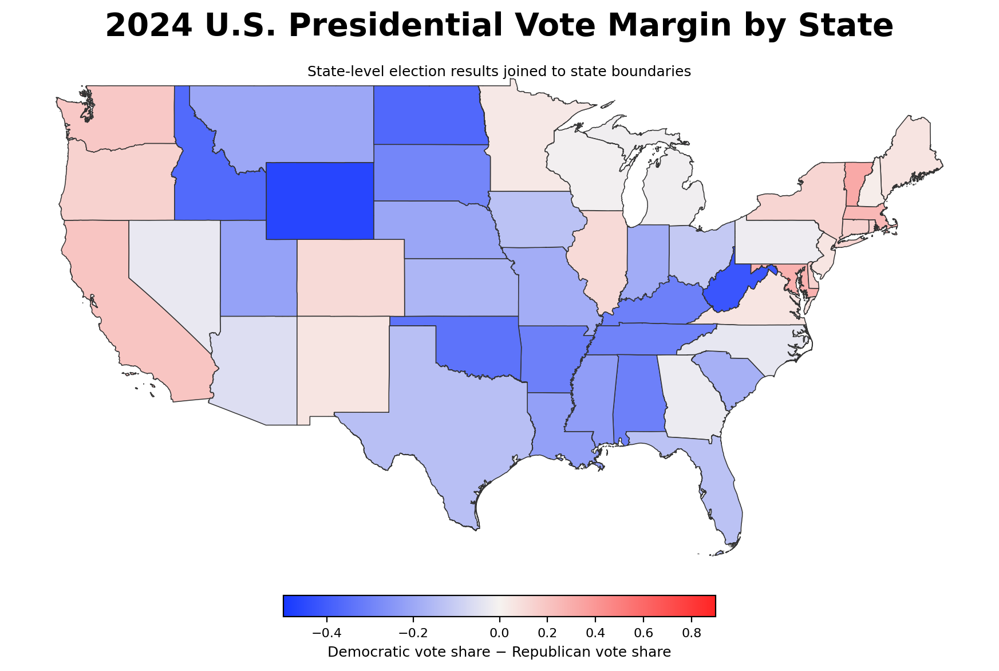
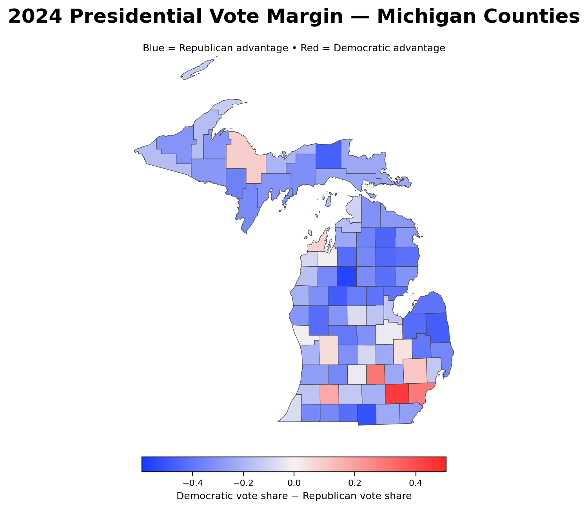
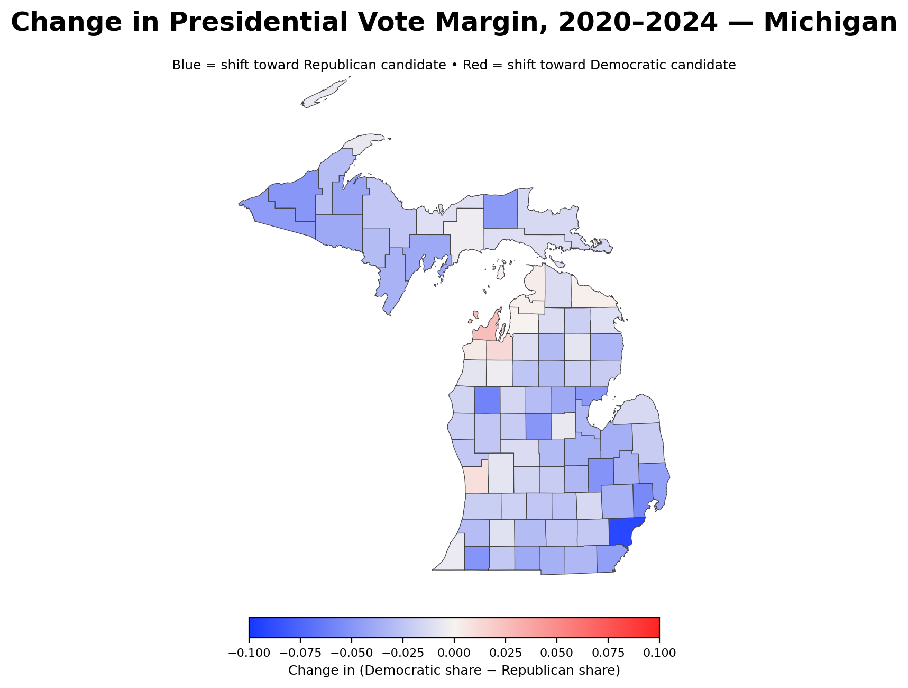

# ElectionAtlas

**QGIS spatial analysis of the 2020 and 2024 U.S. presidential elections, combining national state-level patterns with county-level change in Michigan.**



## Overview

ElectionAtlas examines presidential voting patterns at two geographic scales. A national state-level view provides context for the 2024 election, while county-level analysis focuses on Michigan and the change in vote margin between 2020 and 2024.

The project was developed from coursework in geospatial cartography and reorganized as a reproducible portfolio project. The repository keeps the QGIS project, compact spatial data, election tables, map outputs, and methodology together.

## Key Questions

- How did the 2024 presidential vote margin vary across Michigan counties?
- Which Michigan counties shifted toward the Republican or Democratic candidate between 2020 and 2024?
- How does Michigan fit within the broader 2024 state-level electoral pattern across the United States?

## Michigan: 2024 Vote Margin



County election results are joined to county boundaries with five-digit county FIPS identifiers. Vote margin is represented as:

`Democratic vote share - Republican vote share`

Negative values indicate a Republican advantage and positive values indicate a Democratic advantage.

## Michigan: 2020–2024 Shift



The change layer compares the same vote-margin measure across elections:

`2024 margin - 2020 margin`

Negative values indicate movement toward the Republican candidate relative to 2020, while positive values indicate movement toward the Democratic candidate.

## GIS Workflow

1. Loaded U.S. state and county boundaries into QGIS.
2. Filtered the county layer to Michigan.
3. Loaded 2020 and 2024 election results as CSV tables.
4. Joined county results to Michigan boundaries using county FIPS codes.
5. Calculated Democratic-minus-Republican vote margins.
6. Calculated the 2020–2024 change in county vote margin.
7. Joined 2024 **state-level** results to state boundaries for the national view.
8. Applied diverging thematic symbology and composed multi-scale cartographic outputs.

## Skills Demonstrated

- QGIS
- Vector GIS
- Tabular-to-spatial joins
- FIPS-based geographic identifiers
- GeoPackage and CSV data management
- Attribute expressions and derived variables
- Choropleth / diverging thematic mapping
- Multi-scale cartographic design
- Election-data visualization
- Spatial data validation

## Repository Structure

```text
ElectionAtlas/
├── README.md
├── .gitignore
├── project/
│   └── election-atlas.qgz
├── data/
│   ├── election_boundaries.gpkg
│   ├── 2020_michigan_county_results.csv
│   ├── 2024_michigan_county_results.csv
│   ├── 2020_us_state_results.csv
│   ├── 2024_us_state_results.csv
│   └── README.md
├── images/
│   ├── us-2024-state-margin.png
│   ├── michigan-2024-margin.png
│   └── michigan-2020-2024-shift.png
└── docs/
    └── methodology.md
```

## Open the QGIS Project

1. Clone or download this repository.
2. Open `project/election-atlas.qgz` in QGIS 3.x.
3. The project uses relative paths to the packaged `data/` directory.

The vector boundaries are stored in a GeoPackage instead of a collection of shapefile components to keep the repository compact and portable.

## Data Sources

- **Boundary data:** U.S. Census Bureau, TIGER/Line geographic boundary files (2023).
- **County-level election results:** Tony McGovern, *US County Level Election Results 08–24*.
- **State-level election tables:** packaged with the original analysis and normalized for the portfolio project.

See [`data/README.md`](data/README.md) for details.

## Notes and Limitations

Election maps describe geographic voting patterns; they do not explain why voters or places changed between elections. County-level aggregates should not be interpreted as individual-level voter behaviour.

The national layer intentionally uses state-level results and the Michigan analysis uses county-level results, keeping the geographic unit of the election table aligned with the mapped boundary layer.

## Academic Integrity

This repository contains university coursework shared for portfolio review and educational reference only. Copying, redistributing, or submitting this work as coursework is not permitted.

See [ACADEMIC_INTEGRITY.md](ACADEMIC_INTEGRITY.md) for details.
